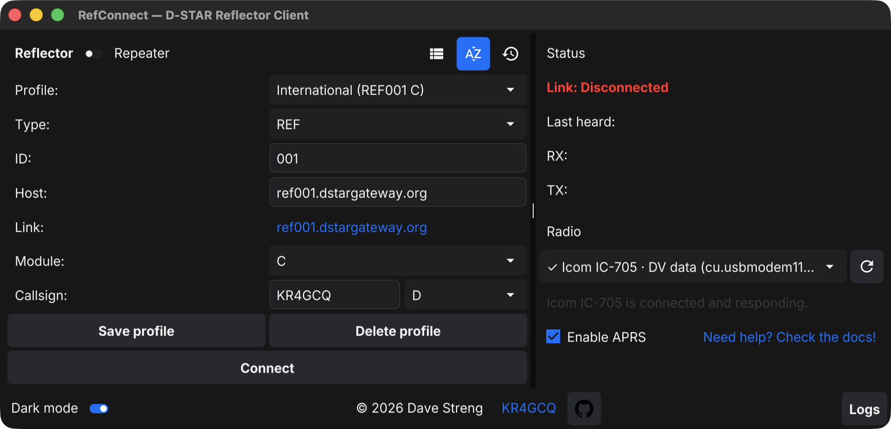

[](https://github.com/S7R4nG3/refconnect/releases/latest)   [](https://github.com/S7R4nG3/refconnect/actions/workflows/dependabot/dependabot-updates)     [](https://github.com/S7R4nG3/refconnect/actions/workflows/ci.yml)

# RefConnect

A D-STAR reflector client for macOS, Windows, and Linux that connects your D-STAR radio to internet-based reflectors via serial port. Supports DExtra (XRF), DPlus (REF), XLX, and DCS reflectors, and can link directly to a repeater's gateway.



--- 

## Features

- Multi-OS Support! (Linux/MacOS/Windows)
- Connect to REF/XRF/XLX/DCS reflectors via the DPlus, DExtra and DCS protocols
- Link straight to a repeater's gateway (DPlus, DExtra or DCS) with the Reflector ⟷ Repeater switch
- Supports ICOM (DV Gateway Terminal) and Kenwood (MMDVM) radio protocols
- Automatic radio detection — recognises the Icom IC-705, ID-52 and ID-52 PLUS and the Kenwood TH-D75, picks the right port and protocol
- Optional APRS — forwards the GPS position from your radio's transmissions to APRS-IS and the reflector (D-PRS)
- Saved profiles with friendly names, sorting (saved order, A–Z, most recent) and last-used memory
- Checks for new releases on launch
- Dark, light, or system theme support
- Timestamped activity log

## Simple Setup

MacOs & Linux:

```shell
curl -fsSL https://raw.githubusercontent.com/S7R4nG3/refconnect/main/configs/setup.sh | sh
```

Windows:

```powershell
iwr -useb https://raw.githubusercontent.com/S7R4nG3/refconnect/main/configs/setup.ps1 | iex
```

Linux package repositories (amd64/arm64, updates via `apt upgrade` / `dnf upgrade`):

```shell
# Debian/Ubuntu
sudo curl -fsSLo /usr/share/keyrings/refconnect.gpg https://s7r4ng3.github.io/refconnect/refconnect.gpg
echo "deb [signed-by=/usr/share/keyrings/refconnect.gpg] https://s7r4ng3.github.io/refconnect/apt stable main" \
  | sudo tee /etc/apt/sources.list.d/refconnect.list
sudo apt update && sudo apt install refconnect

# Fedora/RHEL
sudo curl -fsSLo /etc/yum.repos.d/refconnect.repo https://s7r4ng3.github.io/refconnect/rpm/refconnect.repo
sudo dnf install refconnect
```

The `.deb`, `.rpm` and `.AppImage` files are also attached to each [release](https://github.com/S7R4nG3/refconnect/releases).

Linux builds need glibc 2.38+ (Debian 13+, Ubuntu 24.04+, Fedora 39+). Portable tarball fallback (`setup.sh` above) still works. See [docs/PACKAGING.md](docs/PACKAGING.md) for details.

Check out the [Wiki](https://github.com/S7R4nG3/refconnect/wiki) for more information!


## Configuration

On first launch, a default configuration is created at:

```
~/.config/refconnect/config.yaml
```

Key settings:

```yaml
version: 1
callsign: N0CALL
callsign_suffix: G
radio:
    port: /dev/cu.usbmodem1203
    protocol: DV-GW              # "DV-GW" (ICOM) or "MMDVM" (Kenwood)
reflectors:
    - name: REF001 C
      host: ref001.dstargateway.org
      port: 20001
      module: C
      protocol: DPlus
      label: International      # optional friendly name
    - name: W4ABC B             # a repeater profile
      host: w4abc.example.org
      port: 20001
      module: B
      protocol: DPlus
      repeater_call: W4ABC
last_used_reflector: "REF001 C"
ui:
    theme: system                # "dark", "light", or "system"
    log_max_lines: 500
    window_width: 960
    window_height: 720
    profile_sort: name           # "" (saved order), "name" or "recent"
```

| Field | Description |
|---|---|
| `callsign` | Your amateur radio callsign |
| `callsign_suffix` | Gateway module suffix (e.g. `G` for gateway). This is the 8th character of your callsign as shown in Via/Peer on reflector dashboards |
| `radio.port` | Serial port path for your radio |
| `radio.protocol` | `DV-GW` for ICOM radios, `MMDVM` for Kenwood radios. Baud rate is set automatically (38400 / 115200) |
| `reflectors` | Saved reflector and repeater profiles, selectable from the Connect panel |
| `reflectors[].label` | Optional friendly name shown in the Profile dropdown |
| `reflectors[].repeater_call` | Set on repeater profiles — the repeater's callsign (no module) |
| `last_used_reflector` | Profile reselected on the next launch |
| `aprs.enabled` | Turn APRS position reporting on or off (also the **Enable APRS** checkbox) |
| `ui.theme` | `dark`, `light`, or `system` |
| `ui.profile_sort` | Profile dropdown order: saved order (empty), `name` (A–Z) or `recent` |

## Usage

1. **Connect your radio** — Plug in your radio and turn it on. RefConnect detects supported radios, selects the right serial port and sets the protocol (ICOM or Kenwood) automatically; the hint under the port selector shows the radio's status. For a radio it doesn't recognise, select its port and choose the protocol yourself.
2. **Select a reflector or repeater** — Use the **Reflector ⟷ Repeater** switch at the top of the Connect panel, then choose a saved profile from the Profile dropdown, or fill in the fields to create a new one.
3. **Enter your callsign** — Set your callsign and gateway module suffix.
4. **Click Connect** — The status panel will update once the link is established. The connected profile is remembered and reselected automatically on the next launch.
5. **Transmit** — Key up on your radio! Welcome to D-STAR!

The log panel shows timestamped activity including connections, heard callsigns, and errors.

### Linking to a repeater

Flip the switch at the top of the Connect panel to **Repeater** to link to a repeater's gateway instead of a reflector. Enter the repeater's callsign in the **Repeater** field, its gateway address in **Host**, pick the **Module**, and choose the **Protocol** (DPlus by default, or DExtra / DCS). The switch is locked while you're connected — disconnect first to change modes.

### Saving profiles

The Connect panel keeps a list of saved profiles you can switch between via the **Profile** dropdown. Reflector and repeater profiles are listed separately — the dropdown shows the ones for the current mode, and each mode remembers its own selection.

- **Save profile** — captures the current fields and writes the entry into `config.yaml` under `reflectors`. The profile is keyed by a name derived from the form (e.g. `REF001 C` or `W4ABC B`); saving with the same name overwrites the existing entry, otherwise a new one is appended. You'll be asked for an optional friendly name, shown in the dropdown as e.g. `International (REF001 C)`.
- **Delete profile** — removes the currently selected entry from the dropdown and from `config.yaml`.
- **Sort** — the buttons at the top right of the panel order the dropdown by saved order, A–Z, or most recently connected.
- **Last used** — the most recent profile you connected to is stored in `last_used_reflector` and pre-selected on next launch.

Because profiles live in `config.yaml`, you can migrate them between devices by copying that file. Callsign and gateway suffix are global and apply to every profile.

## License

See [LICENSE](LICENSE).

©️ 2026 Dave Streng (KR4GCQ)

This project is supported by me alone... Feel free to [Donate](https://www.paypal.com/donate/?hosted_button_id=J3YVE7V6F8NN2) if you're feeling generous! :)